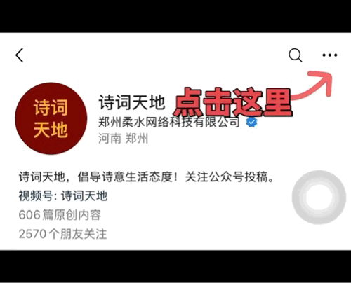

# 二十四史160句：三千年兴亡，四千万字，读懂一句，少走十年弯路（建议收藏）

- ** ◆ ◆**

二十四史，三千年兴亡，四千万字。

帝王将相成灰，朝代更迭如梦，唯有那些从血火中淬炼出来的句子，至今仍在人间流传。

它们不教你投机，不劝你躺平，只把最硬的生存逻辑摊开给你看——读懂一句，少走十年弯路。

**01**

**修身立德**

**【1】义感君子，利动小人。**

出处：《晋书·符登传》

感悟：利益面前见人心。

**【2】水至清则无鱼，人至察则无徒。**

出处：《汉书·东方朔传》

感悟：水清无鱼，人察无徒。

**【3】太刚则折，至察无徒。**

出处：《晋书·周顗传》

感悟：刚易折，察无友。

**【4】评大功者不录小过，举大善者不疵细瑕。**

出处：《汉书·陈汤传》

感悟：看人先看成事。

**【5】附小人者必小人，附君子者未必君子。**

出处：《明史》

感悟：苍蝇附骥终是蝇。

**【6】天下皆知取之为取，而莫知与之为取。**

出处：《后汉书·桓谭传》

感悟：会舍才会得。

**【7】贪于近者则贵远，溺于利者则伤名。**

出处：《晋书》

感悟：贪小便宜吃大亏。

**【8】不患位之不尊，而患德之不崇。**

出处：《后汉书》

感悟：怕的是担不起。

**【9】反听之谓聪，内视之谓明，自胜之谓强。**

出处：《史记·商君列传》

感悟：能管住自己才是真强。

**【10】修身者智之府也，爱施者仁之端也。**

出处：《史记·屈原贾生列传》

感悟：修身是根基。

**【11】新沐者必弹冠，新浴者必振衣。**

出处：《史记·屈原贾生列传》

感悟：干净人不愿沾灰。

**【12】君子立身，虽云百行，唯诚与孝最为其首。**

出处：《隋书·文帝纪》

感悟：诚和孝是底子。

**【13】清者莅职之本，俭者持身之道。**

出处：《周书》

感悟：清廉节俭，缺一不可。

**【14】尚俭者开富之源，好奢者起贫之兆。**

出处：《魏书》

感悟：奢侈是贫穷的前奏。

**【15】不充诎于富贵，不遑遑于所欲。**

出处：《梁书》

感悟：欲望不该牵着鼻子走。

**【16】以清白遗子孙，不亦厚乎。**

出处：《南史·徐勉传》

感悟：清白传家最厚重。

**【17】居官当廉正自守，毋黩货以丧身败家。**

出处：《元史·刘斌传》

感悟：守不住底线就守不住一切。

**【18】求治之道，莫先于正风俗。**

出处：《明史》

感悟：风气正了，问题自消。

**【19】盛名之下，其实难副。**

出处：《后汉书·黄琼传》

感悟：名气越大，越要清醒。

**【20】少壮不努力，老大徒伤悲。**

出处：《汉书》

感悟：年轻时别偷懒。

**【21】遗子黄金满籝，不如一经。**

出处：《汉书·韦贤传》

感悟：留书比留钱强。

**【22】不修其身，虽君子而为小人。**

出处：《宋史》

感悟：不修德，身份再高也被人看轻。

**【23】廉者常乐无求，贪者常虞不足。**

出处：《北史》

感悟：无求才真自在。

**02**

**识人用人**

**【24】以铜为镜，可以正衣冠；以古为镜，可以知兴替；以人为镜，可以明得失。**

出处：《旧唐书·魏征传》

感悟：身边需要一面真镜子。

**【25】得人之道，在于知人；知人之法，在于责实。**

出处：《宋史》

感悟：看他做过什么，不是听他吹什么。

**【26】非成业难，得贤难；非得贤难，用之难；非用之难，任之难。**

出处：《三国志·钟离牧传》

感悟：用人最难的是相信到底。

**【27】人之相知，贵在知心。**

出处：《宋书》

感悟：知心比相识重要。

**【28】天生才甚难，不忍以微瑕弃也。**

出处：《明史》

感悟：别因小毛病错过人才。

**【29】人之聪明，多失之浮炫。**

出处：《金史》

感悟：真聪明是懂得收。

**【30】不以人所短弃其所长。**

出处：《三国志·诸葛恪传》

感悟：抓着短处不放，会错过长处。

**【31】观其言，察其行。**

出处：《三国志》

感悟：听其言更要观其行。

**【32】苍蝇之飞，不过十步。**

出处：《后汉书》

感悟：看一个人走多远就知他有多大。

**【33】司马昭之心，路人皆知。**

出处：《三国志·三少帝纪》

感悟：野心藏不住，早晚露底。

**【34】人未己知，不可急求其知。**

出处：《晋书》

感悟：交浅不言深。

**【35】木秀于林，风必摧之。**

出处：《晋书》

感悟：太优秀也是一种风险。

**【36】皮之不存，毛将焉附。**

出处：《晋书》

感悟：根基没了，一切都白搭。

**【37】将顺其美，匡救其恶。**

出处：《后汉书》

感悟：好朋友是帮你补短板的。

**【38】不以言举人，不以人废言。**

出处：《晋书》

感悟：说话好听不代表靠谱。

**【39】君子之交淡如水。**

出处：《宋书》

感悟：淡才能长久。

**【40】亲贤臣，远小人。**

出处：《三国志·诸葛亮传》

感悟：亲近谁决定你成为谁。

**【41】良将用兵，若良医疗疾。**

出处：《三国志》

感悟：对症下药才能解决问题。

**【42】人非有才之难，而非用其才之难。**

出处：《明史》

感悟：用对人比有才难。

**【43】士别三日，即更刮目相待。**

出处：《三国志·吕蒙传》

感悟：人都在变，别用老眼光看人。

**【44】燕雀安知鸿鹄之志哉。**

出处：《史记·陈涉世家》

感悟：格局不同，不必强求。

**【45】王侯将相宁有种乎。**

出处：《史记·陈涉世家》

感悟：出身不是终点。

**【46】善作者不必善成，善始者不必善终。**

出处：《史记·燕世家》

感悟：开好头不等于能收好尾。

**03**

**治国理政**

**【47】农，天下之大本。**

出处：《汉书·文帝纪》

感悟：别忘本，人会飘。

**【48】治天下者当用天下之心为心。**

出处：《汉书·鲍宣传》

感悟：只想着自己，走不远。

**【49】顺德者昌，逆德者亡。**

出处：《汉书·高帝纪上》

感悟：靠不正当手段赢来的守不住。

**【50】朝廷行事苟不自正，何以正天下。**

出处：《金史·世宗上》

感悟：以身作则是说服力的起点。

**【51】人不率则不从，身不先则不信。**

出处：《宋史》

感悟：自己先做到，别人才信你。

**【52】不务先富民，而唯言益国。**

出处：《南齐书》

感悟：民穷国不可能富。

**【53】为国之道，食不如信。**

出处：《宋书·江夷传》

感悟：信任比粮食更珍贵。

**【54】国以民为本。**

出处：《三国志》

感悟：根基是民心。

**【55】治世以大德，不以小惠。**

出处：《三国志》

感悟：小恩小惠收买不了天下。

**【56】安天下者，必先安民。**

出处：《隋书》

感悟：对身边的人好就是安天下。

**【57】务农重本，国之大纲。**

出处：《晋书》

感悟：种地养家是根本。

**【58】礼义廉耻，国之四维。**

出处：《北史》

感悟：四维不张，家国难安。

**【59】有文事者，必有武备。**

出处：《三国志》

感悟：两手准备，有备无患。

**【60】作法于凉，其弊犹贪。**

出处：《隋书》

感悟：标准降低，底线会跟着滑。

**【61】变通革弊，与时宜之。**

出处：《晋书》

感悟：守着老办法不等于坚持。

**【62】全一人者德之轻，成天下者功之重。**

出处：《晋书》

感悟：格局藏在你在乎谁里。

**【63】散施而求报，非义也。**

出处：《陈书》

感悟：施恩望报，不如不施。

**【64】民惟邦本，本固邦宁。**

出处：《明史》

感悟：民心稳了，天下就稳了。

**【65】为政之道，务于多闻。**

出处：《梁书》

感悟：兼听则明，偏信则暗。

**【66】理有一日之短，事有千载之长。**

出处：《北史》

感悟：眼前得失放到时间长河里看。

**【67】官不私亲，法不遗爱。**

出处：《隋书》

感悟：当官最怕因人废法。

**【68】刑罚不中，则民无所措手足。**

出处：《明史》

感悟：法律失当，百姓不知该怎么做。

**【69】以百姓心为心。**

出处：《梁书》

感悟：民之所望，政之所向。

# 诗心若无处归依， 就会在喧嚣中沉没。 我们设立：守护诗脉群 每日寄诗，互守心灯， 不让诗脉熄灭。 若你愿意留一盏心灯， 可扫码入群 今日寄诗已在等你。 

**04**

**决断谋略**

**【70】智者千虑，必有一失；愚者千虑，必有一得。**

出处：《史记·淮阴侯列传》

感悟：别小看任何人，别高看自己。

**【71】先发制人，后发制于人。**

出处：《汉书·项籍传》

感悟：该出手时就出手。

**【72】成远算者不恤近怨，任大事者不顾细谨。**

出处：《明史·汤和传》

感悟：做大事别算小账。

**【73】智者弃短取长，以致其功。**

出处：《后汉书·王符传》

感悟：扬长比补短划算。

**【74】运筹帷幄之中，决胜千里之外。**

出处：《史记·高祖本纪》

感悟：真正的功夫在幕后。

**【75】楚虽三户，亡秦必楚。**

出处：《史记·项羽本纪》

感悟：人心不死，希望不灭。

**【76】明者见危于无形，智者见祸于未萌。**

出处：《三国志·钟会传》

感悟：事后诸葛亮不算远见。

**【77】用兵之道，先胜后战。**

出处：《三国志·荀彧传》

感悟：想清楚再动手。

**【78】聚如丘山，散如风雨。**

出处：《元史·郝经传》

感悟：收放自如是大本事。

**【79】事贵应机，兵不厌诈。**

出处：《北齐书》

感悟：抓住时机比死守套路管用。

**【80】以饱待饥，以逸击劳。**

出处：《三国志》

感悟：以逸待劳，不跟对方节奏走。

**【81】战捷之后，常苦轻敌。**

出处：《三国志》

感悟：胜仗之后最容易栽跟头。

**【82】将在外，君命有所不受。**

出处：《史记·孙子吴起列传》

感悟：懂变通才能成事。

**【83】千载一时，不可失也。**

出处：《隋书》

感悟：抓住机遇窗口期。

**【84】不作无益害有益。**

出处：《隋书》

感悟：别拿有用换无用。

**【85】善治病者，必医其受病之处。**

出处：《隋书》

感悟：解决问题要找根源。

**【86】时乎时乎，去不可邀。**

出处：《北史》

感悟：时光一去不回头。

**【87】失之东隅，收之桑榆。**

出处：《后汉书·冯异传》

感悟：此处失去，别处补回。

**【88】功者难成而易败，时者难得而易失。**

出处：《史记》

感悟：时机错过不再来。

**【89】不飞则已，一飞冲天。**

出处：《史记·滑稽列传》

感悟：沉默是为了爆发。

**【90】任之重者莫如身，途之畏者莫如口。**

出处：《北齐书》

感悟：最该敬畏的是自己的言语。

**【91】前事之不忘，后事之师也。**

出处：《史记·秦始皇本纪》

感悟：记教训，不记怨恨。

**【92】苟利于民，不必法古。**

出处：《北史》

感悟：真有用的事，不必拘泥旧法。

**05**

**居安思危**

**【93】居高而必危，每处满而防溢。**

出处：《北史·后妃列传》

感悟：得意时留一分警惕。

**【94】墙高基下，虽得必失。**

出处：《后汉书·郭太传》

感悟：根基不牢，早晚要塌。

**【95】位尊身危，财多命殆。**

出处：《后汉书·冯衍传》

感悟：拥有越多，担子越重。

**【96】上有忧危之心，下有安泰之象。**

出处：《宋史》

感悟：上面松弛，下面危险。

**【97】祸患常积于忽微，而智勇多困于所溺。**

出处：《新五代史》

感悟：大祸从小处攒起。

**【98】成败相因****，****理****不常泰。**

出处：《南史·宋本纪》

感悟：胜败本是一体两面。

**【99】宜如临深渊，如履薄冰。**

出处：《后汉书·光武帝纪上》

感悟：谨慎不是胆小。

**【100】成立之难如升天，覆坠之易如燎毛。**

出处：《新唐书》

感悟：毁掉只需一把火。

**【101】单者易折，众则难摧。**

出处：《魏书》

感悟：一个人扛，容易断。

**【102】善操理者不能有全功，善处身者不能无过失。**

出处：《旧五代史》

感悟：别追求完美人生。

**【103】前车覆，后车诫。**

出处：《汉书·贾谊传》

感悟：别人的跟头别白摔。

**【104】明者远见于未萌，智者避危于无形。**

出处：《汉书》

感悟：高人在风险未现时已避开。

**【105】物盛则衰，时极而转。**

出处：《史记》

感悟：到了顶点就该下坡了。

**【106】罄南山之竹，书罪无穷。**

出处：《旧唐书·李密传》

感悟：恶行越攒越重。

**【107】负薪救火，扬汤止沸。**

出处：《旧唐书·魏征传》

感悟：治标不治本等于没治。

**【108】过而不改，是谓过矣。**

出处：《汉书·成帝纪》

感悟：知错不改才是真错。

**【109】朽株将拔，非待寻斧。**

出处：《陈书》

感悟：该消的自会消亡。

**【110】取草绝根，在于未蔓。**

出处：《陈书》

感悟：苗头阶段最好处理。

**【111】养鱼沸鼎之中，栖鸟烈火之上。**

出处：《后汉书》

感悟：凶险到了极点还不自知。

**【112】爱之则不觉其过，恶之则不知其善。**

出处：《后汉书》

感悟：偏心会让人失明。

**【113】常胜之家，难与虑敌。**

出处：《后汉书》

感悟：总赢的人最容易轻敌。

**【114】涓涓不塞，将为江河。**

出处：《周书》

感悟：小问题不管会变大灾。

**【115】履****薄临深，悬旌驭****马。**

出处：《周书》

感悟：身居高位，如临深渊。

**06**

**为学成长**

**【116】有志者事竟成。**

出处：《后汉书·耿弇传》

感悟：坚持到底的人等到了结果。

**【117】不入虎穴，焉得虎子。**

出处：《后汉书·班超传》

感悟：怕冒险就什么也得不到。

**【118】人生在勤，不索何获。**

出处：《后汉书·张衡传》

感悟：运气眷顾行动的人。

**【119】读书百遍，其义自见。**

出处：《三国志·王肃传》

感悟：读得多了自然懂。

**【120】精诚所至，金石为开。**

出处：《后汉书》

感悟：不是方法不对，是诚意不够。

**【121】桃李不言，下自成蹊。**

出处：《史记·李将军列传》

感悟：有分量的人不必自夸。

**【122】岁月不居，时节如流。**

出处：《三国志·孙韶传》

感悟：别总觉得来日方长。

**【123】一沐三捉发，一饭三吐哺。**

出处：《史记·鲁周公世家》

感悟：真正的诚意是放下自己的方便。

**【124】涓流虽寡，浸成江河。**

出处：《后汉书》

感悟：小积累能成大事。

**【125】涣散者，不可复收。**

出处：《晋书》

感悟：人心散了，队伍就难带了。

**【126】书籍之事，患人不好，好之无伤也。**

出处：《三国志·三嗣主传》

感悟：爱读书总没坏处。

**【127】天将降大任于是人也。**

出处：《明史》

感悟：受得了苦才撑得住大事。

**【128】人能弘道，非道弘人。**

出处：《晋书》

感悟：路是人走出来的。

**【129】始之不难，行之惟艰。**

出处：《宋书》

感悟：开始容易，坚持难。

**【130】非知之难，行之惟难。**

出处：《明史》

感悟：知道道理和做到是两回事。

**【131】良玉未剖，与瓦石相类。**

出处：《周书》

感悟：没经过打磨，天才也像废石。

**【132】积德累行，不知其善，有时而用。**

出处：《梁书》

感悟：别嫌日行一善没用，关键时刻就见了。

**【133】学不精勤，不如不学。**

出处：《周书》

感悟：学个半吊子不如不学。

**【134】尺有所短，寸有所长。**

出处：《宋书》

感悟：每个人都有短板，别太焦虑。诗词征稿中，关注诗词天地投稿

**【135】玉不琢，不成器；人不学，不知道。**

出处：《隋书》

感悟：学习是对自己最大的雕琢。

**【136】天下事有难易乎？为之，则难者亦易矣。**

出处：《明史》

感悟：动手做就不难。

**【137】士不可以不弘毅，任重而道远。**

出处：《三国志》

感悟：肩上有担子，脚下才有力量。

**【138】学以从政，不学无术。**

出处：《隋书》

感悟：不学习连事都办不好。

**07**

**人情世故**

**【139】临渊羡鱼，不如退而结网。**

出处：《汉书·董仲舒传》

感悟：羡慕不如动手。

**【140】天知、地知、我知、子知，何谓无知。**

出处：《后汉书·杨震传》

感悟：鬼神在旁，莫欺本心。

**【141】浊其源而望其流，曲其形而欲其直，不可得也。**

出处：《后汉书·刘般传》

感悟：根上歪了，别想结果正。

**【142】人心不同，各如其面。**

出处：《三国志》

感悟：别指望谁都懂你。

**【143】家贫则思良妻，国乱则思良相。**

出处：《史记·魏世家》

感悟：失去时才知珍贵。

**【144】百里不同风，千里不同俗。**

出处：《汉书》

感悟：入乡先问俗。

**【145】士为知己者死，女为悦己者容。**

出处：《史记·刺客列传》

感悟：人这一生，不过寻一知己。

**【146】待人以诚，人亦以诚待我。**

出处：《元史》

感悟：真心换真心。

**【147】患人知进而不知退，知欲而不知足。**

出处：《三国志·王昶传》

感悟：不懂适可而止，必生困辱。

**【148】人各有志，所规不同。**

出处：《三国志·邴原传》

感悟：别拿自己标准衡量别人。

**【149】鸟之将死，其鸣也哀；人之将死，其言也善。**

出处：《史记·滑稽列传》

感悟：临终之言卸下了所有伪装。

**【150】寒之于衣，不待轻暖。**

出处：《汉书·食货志》

感悟：谈道德之前先管温饱。

**【151】贤达哀乐，不在穷通祸福之间。**

出处：《辽史》

感悟：真正通达的人不任凭遇摆布。

**【152】人生不得行胸怀，虽寿百岁犹为夭。**

出处：《南史》

感悟：没按自己的心意活过才是短命。

**【153】举世皆浊我独清，众人皆醉我独醒。**

出处：《史记·屈原贾生列传》

感悟：清醒的人注定孤独。

**【154】大丈夫处世，当立功名。**

出处：《后汉书》

感悟：别在烂人破事上浪费功夫。

**【155】不能流芳百世，亦当遗臭万年。**

出处：《晋书·桓温传》

感悟：不甘平庸，但不能走极端。

**【156】此处不留人，自有留人处。**

出处：《南史》

感悟：不必在一棵树上吊死。

**【157】知足不辱，知止不殆。**

出处：《晋书》

感悟：知道适可而止是种大智慧。

**【158】天下熙熙，皆为利来；天下攘攘，皆为利往。**

出处：《史记·货殖列传》

感悟：承认利，不丢人。

**【159】良药苦口利于病，忠言逆耳利于行。**

出处：《史记·留侯世家》

感悟：真话都不好听。

**【160】飞鸟尽，良弓藏；狡兔死，走狗烹。**

出处：《史记·越王勾践世家》

感悟：对人性别抱幻想。

点击上方关注【诗词天地视频号】

**译文：**树立德行，最可贵的是使它不断增长；而除掉毛病，最好是除得干净彻底。

二十四史，三千年兴亡，四千万字。这160句，是古人用血泪和性命换来的生存智慧。读懂一句，少走十年弯路；悟透三句，余生不再迷茫。

点个【赞】与【在看】 ，把这160句智慧转发给家人朋友，一起读史明智。

**100句精华，句句经典，值得点赞！**

*文章内容综合来源于：人民日报，编辑：霄风。

平台改版，未星标账号，容易错过推送。

喜欢诗词君，点亮星标，守候每一期诗情画意。

#守护诗脉 #诗词 #国学 #养生

---
原文链接：https://mp.weixin.qq.com/s?__biz=MzI2NDI3ODk0OQ%3D%3D&mid=2248164184&idx=1&sn=de39d13b393c19984e47bd387b67c0e2&chksm=e95be592de2c6c84df85312844f7a1cd35f2df476cc52f8efe1a97a59c82a156a3aeb5cb79ee
